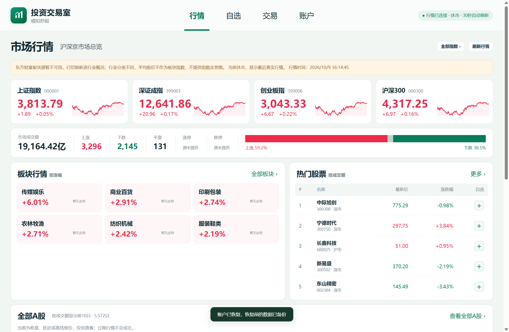
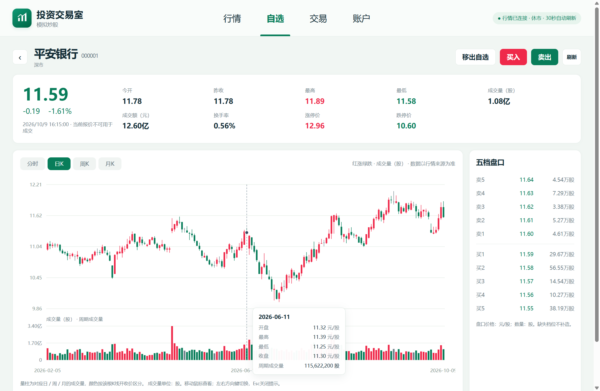

# 投资交易室

联网行情、本地账户的 Windows / macOS A 股模拟炒股软件。行情、自选、交易和账户各有独立页面，使用虚拟现金和本机账本，不连接券商或真实资金账户。

项目源码采用 [MIT 许可证](LICENSE)，允许使用、修改、分发和商业使用，分发时保留版权及许可证。行情数据和第三方组件的许可见 [THIRD_PARTY_NOTICES.md](THIRD_PARTY_NOTICES.md)。`private: true` 用来避免误发布到 npm，不影响本项目的开源许可。

## 界面

以下截图来自 1.2.3 的 Windows 隔离测试环境，1.3.0 沿用相同主要界面和功能。截图中的价格是拍摄时的历史行情，不能作为 Mac 实机验收证据。





## 功能

- 行情首页显示指数、行业板块、市场广度、成交额热门榜及股票简表；“更多”进入完整列表，支持沪深京筛选、名称或代码搜索、排序和分页。
- 股票详情支持分时、日 K、周 K、月 K、成交量副图和五档盘口。鼠标或键盘定位时，价格和量柱使用同一时间轴。指数和板块按各自类型显示详情。
- 点击股票右侧的 `+` 加入自选，点击 `−` 移除；自选股票可进入详情和交易页面。
- 限价模拟买卖、部分成交、撤单、持仓、委托与成交记录，支持资金和数量冻结、当日到期、T+1 及 FIFO 成本核算。
- 账户显示现金、总资产、持仓市值、累计盈亏、净投入收益率与当天盈亏。可充值或提取虚拟现金、设置目标总资产和重置账户；重置默认保留自选，也可明确选择清空。
- 资金调整、重置和恢复前自动保存完整本地备份；支持自动备份列表、预览恢复、JSON 导出和跨设备恢复。预览后账户改变会要求重新预览。
- 自动更新行情，保留中文输入、光标和选区。断网时仍可查看账户和已缓存行情，失效报价不能用于成交。

## 使用安装包

从本仓库的 [Releases](https://github.com/baixiangguo-box/investment-trading-room/releases) 下载安装包。安装包自带运行环境，使用者无需安装 Node.js。

| 系统 | 架构与文件 | 安装方式 |
|---|---|---|
| Windows 11 | x64：`InvestmentTradingRoom-Setup-<版本>-x64.exe` | 运行 EXE，使用“投资交易室”快捷方式启动 |
| macOS 13 或更新版本，Apple Silicon | arm64：`InvestmentTradingRoom-Mac-<版本>-arm64.dmg` | 打开 DMG，将“投资交易室”拖入 Applications，再从应用程序启动 |

Mac 的“关于本机”中，显示 Apple 芯片（M 系列）的使用 arm64 包；本版本不提供 Intel Mac 支持。ZIP 为替代分发包，解压后将 `.app` 放入 Applications。Mac 最低版本来自 [Electron 44 的系统要求](https://www.electronjs.org/blog/electron-44-0)；自动化 Runner 使用 macOS 15，macOS 13/14 的实机兼容性尚未验收。

**Mac 版本属于预览：尚未完成真实 Mac 的 DMG 安装、系统中文输入法和原生文件对话框验收。** 构建和自动化结果以 [Actions](https://github.com/baixiangguo-box/investment-trading-room/actions) 和 [跨平台验收记录](docs/CROSS_PLATFORM.md) 为准。没有 Apple Developer 凭据时包仅做 ad-hoc 开发签名，未进行 Developer ID 签名或公证；Gatekeeper 可能阻止启动。遵循系统提供的安全验证流程，不关闭 Gatekeeper/SIP 或删除下载隔离属性。

Mac 菜单提供 Command+C/V/X/A/Z、Command+W 关闭窗口、Command+Q 退出。关闭最后一个窗口会继续在 Dock 驻留，点击 Dock 图标或 Command+N 重新打开；Windows 仍在关闭最后一个窗口时退出。

首次启动设置昵称和模拟本金，默认 10,000 元。行情需联网，完整股票目录在后台加载，具体耗时取决于网络和上游接口。虚拟充值无需支付任何真实资金。

账户数据与程序安装目录分开，覆盖升级不主动清空账户：

- Windows：系统“文档”目录下的“投资交易室数据”，保持 1.2.x 的原位置，兼容被重定向的文档目录。
- macOS：`~/Library/Application Support/org.investment.tradingroom/`。账户、缓存、日志及 Chromium 用户数据都在这里，避免写入应用安装目录或 iCloud 文档。

Windows 卸载保留原数据目录；Mac 删除 `.app` 不会主动删除上述目录。跨平台迁移时，在原平台账户页面“导出备份”，将 JSON 文件传到另一台电脑，在“恢复备份”中核对预览后确认。JSON 保存现金、持仓、委托、成交、自选及资金流水；恢复会生成新账户世代，防止旧请求继续写入。自动备份与账本同库，重要资料仍需外部 JSON 备份。以前在 Mac 从 1.2.x 源码试运行生成的 Documents 数据不会自动迁移，可导出 JSON 后恢复。

现有安装包未进行代码签名，Windows 可能显示发布者未知。下载时核对对应发布提供的 SHA-256 校验值。

## 从源码运行

开发环境：Windows 11 x64，或 macOS 13+ Apple Silicon（arm64）；Node.js 22.13.0 或更新版本（含 `node:sqlite`）、npm。CI 固定 Node.js 24.20.0。依赖仍由 `package-lock.json` 固定为 Electron 44.7.0、electron-builder 26.15.3。

```powershell
npm ci
npm run check
npm test
npm start
```

`npm start` 使用默认本地账户。开发时应另设一个绝对路径，避免接触日常使用的账户：

```powershell
$testDataDirectory = Join-Path (Get-Location) '.qa\manual-profile'
npm start -- "--data-dir=$testDataDirectory"
```

macOS Terminal 中使用独立绝对路径：

```bash
npm start -- "--data-dir=$PWD/.qa/manual-profile"
```

无需配置 API 密钥或登录浏览器。首次 `npm ci` 会下载 Electron 运行环境，因此需要网络。

## 构建 Windows 安装包

```powershell
npm ci
.\scripts\build-win.ps1
node scripts/verify-package.mjs
```

脚本把构建缓存和临时文件放在项目的 `.qa` 目录，并在结束后还原进程环境变量。安装包输出到 `release/`。也可直接运行：

```powershell
npm run package:dir
npm run package:win
```

两条打包命令均带 `--publish never`，不会自行向 GitHub 上传。发布文件可单独校验：

```powershell
Get-FileHash -Algorithm SHA256 .\release\InvestmentTradingRoom-Setup-1.3.0-x64.exe
```

安装包包含本项目 `LICENSE`、`THIRD_PARTY_NOTICES.md`，以及 Electron/Chromium 自带许可文件；不要在二次分发时移除这些文件。

## 构建 macOS 安装包

在 Mac 的 Terminal 执行，或使用 GitHub Actions 的 Mac Runner；Windows 上不能完成 DMG 和 Apple 签名工具验收。

```bash
npm ci
npm run package:mac:arm64
node scripts/verify-package.mjs "release/mac-arm64/投资交易室.app" --arch=arm64
```

输出独立命名的 arm64 DMG 和 ZIP。图标从原绘图脚本生成 1024px PNG 及多尺寸 ICNS；已有图标随源码提供，普通构建无需 Python/Pillow。Mac 的运行时许可保存在 `.app/Contents/Resources`，与 Windows 的安装根目录不同。

默认 Mac 命令仅做 ad-hoc 开发签名，保留 hardened runtime。可选正式流程为 `npm run package:mac:arm64:signed`：签名证书通过本机钥匙串或 `CSC_LINK`/`CSC_KEY_PASSWORD` 配置，公证通过 Apple 身份凭据配置，不能把证书或密钥写入源码。签名后仍须验证真实 Developer ID、`codesign --verify --deep --strict` 和公证/stapler 结果，缺少公证凭据的跳过日志不能称为公证成功。

## GitHub Actions 与发布

[build.yml](.github/workflows/build.yml) 在 PR、main 更新或手动触发时，使用 Windows x64、Mac arm64 原生 Runner；运行语法、160 项逻辑测试、隔离 Electron 回归、构建和包核验，并实际启动生成的 EXE/`.app` 两次检查 SQLite 保存与正常退出。下载结果在对应运行的 Artifacts 中：`packages-windows-x64`、`packages-macos-arm64`，每组含 SHA-256 和构建元数据。最小诊断报告单独上传，不上传测试账本。锁定的 Electron 运行时显式安装，下载最多重试三次；测试失败不自动重试或忽略。

普通提交不创建公开 Release。[release.yml](.github/workflows/release.yml) 由新的 `v*` Tag 或手动输入版本 Tag 触发，重新构建两个目标平台。手动发布必须选择 main，全部成功、Tag 与源码版本一致、三个安装/分发文件齐全后，才在该次运行的源码提交上创建新 Tag 和草稿 Release；所有产物上传完成才公开为预览版。已有 Tag 指向其他提交时拒绝移动。已有 Release 不覆盖；重复发布同一 Tag 会失败。Windows 未签名、Mac 未完成 Developer ID/公证和实机验收的限制写入发布说明。

用户更新软件需要下载新版安装包；GitHub 更新源码不会自动更新已安装的软件。

## 行情与模拟范围

股票目录取自新浪公开接口，报价和股票/指数走势图取自腾讯公开接口；板块优先使用东方财富，不可用时使用新浪行业概况。分类切换会明确提示，缺失数据显示 `—`，不生成价格或替代走势。热门榜按成交额排序。

交易时段当前报价和分时图通常在每轮请求完成后约 5 秒刷新，首页缩略图和 K 线约 30 秒，完整股票目录整批更新至少间隔 60 秒；休市、隐藏窗口或失败时降低频率。上游可能延迟、限流、断开或缺字段，轮询间隔不等于新的成交数据间隔，也不是交易所逐笔实时服务。

交易采用有效对手报价与可用盘口数量的有限深度模型。支持主板、创业板、科创板、北交所股票及科创板 689 代码存托凭证；股票数量单位为股，存托凭证为份。指数、板块和基金不可下单。仅在已核验的连续竞价时段撮合，不模拟完整排队优先级、集合竞价、市价单、盘后交易、公司行为、融资融券或真实证券交收。

**交易日历目前覆盖 2026 年。** 未覆盖年份会暂停模拟成交并提示更新日历；维护新版本时需核验并更新 `core/market-rules.mjs`。

模拟费用固定为佣金万分之三（每笔委托累计最低 5 元）、过户费十万分之一、卖出印花税万分之五，按整数分四舍五入。这是本程序的模拟参数。资金充值和提取不计入盈亏；净投入收益率以净投入为分母，非时间加权收益率，分母不为正或估值不完整时不计算。

程序只向行情源发起只读请求，账户文件保留在本机。公开接口的请求可包含查询的证券代码，但不发送昵称、余额、持仓或交易账本。软件用于模拟交易，不提供投资建议。

## 文档与贡献

- [架构与数据边界](docs/ARCHITECTURE.md)
- [IPC 接口契约](docs/CONTRACT.md)
- [测试方法与覆盖范围](docs/TESTING.md)
- [版本记录](CHANGELOG.md)
- [贡献指南](CONTRIBUTING.md)
- [跨平台审查与验收](docs/CROSS_PLATFORM.md)
